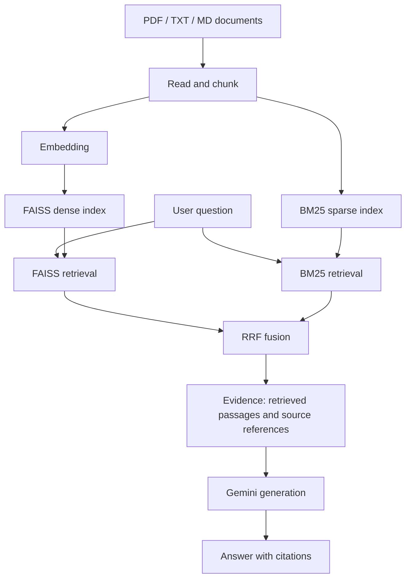

**Language:** English · [Tiếng Việt](./README.vi.md)

# Evidence-Grounded Vietnamese University Admissions Question Answering via Hybrid Retrieval and Reciprocal Rank Fusion


**Short project name:** AdmitRAG VN

**Keywords:** Evidence-Grounded · Hybrid Retrieval · Reciprocal Rank Fusion (RRF) · FAISS · BM25 · RAG · Vietnamese

This project builds a Vietnamese-language admissions question answering
system that runs locally. It focuses on **retrieving evidence** from
documents and **generating answers with source citations**. The core
technique is **hybrid search combining FAISS (dense) and BM25 (sparse)**,
with the two ranked lists merged by **Reciprocal Rank Fusion (RRF)**. No
separate database server is required.

> ⚠️ **LEARNING PROJECT – NOT AN OFFICIAL PRODUCT OR ADVISORY CHANNEL**
>
> This is a hands-on, research-oriented project about Retrieval-Augmented
> Generation (RAG). It **does not represent and is not affiliated with**
> any university, educational institution or government agency
> (including Vietnam's Ministry of Education and Training). The bundled
> data is **simulated demo data**, and AI-generated answers **may be
> wrong, incomplete or out of date**.
>
> **Do not use the output of this system as a basis for admissions
> decisions.** Always verify against official information from the
> institution's website, its admissions announcements, or the portal of
> the competent authority.

## Table of Contents

- [Scope and Disclaimer](#scope-and-disclaimer)
- [Learning Objectives](#learning-objectives)
- [Project Highlights](#project-highlights)
- [Overview](#overview)
- [Architecture](#architecture)
- [Technology and Dependencies](#technology-and-dependencies)
- [System Requirements](#system-requirements)
- [Project Structure](#project-structure)
- [Installation and Local Setup](#installation-and-local-setup)
- [Retrieval Configuration](#retrieval-configuration)
- [Testing](#testing)
- [Limitations and Security Notes](#limitations-and-security-notes)
- [Contributing](#contributing)
- [License](#license)

## Scope and Disclaimer

**What is this project?**

- A learning and experimentation project that demonstrates how to build a
  document-based question answering system in Vietnamese.
- A reference example for anyone who wants to learn about hybrid
  retrieval, RRF and grounded generation.

**What is this project not?**

- It is not an official admissions advisory channel of any organization.
- It is not a reliable source of admissions information for making
  decisions (choosing a major or school, registering preferences,
  submitting applications, and so on).
- Its answers have not been validated for accuracy, completeness or
  currency.

**Notes on usage:**

1. **Simulated data:** the file `tuyen_sinh_demo.md` is **simulated** data
   for demonstration only, not official admissions information. Cut-off
   scores, tuition, quotas, program codes and similar details in it may
   not match reality.
2. **AI-generated answers:** language models can misinterpret or omit
   information, even when sources are cited. Check the content against
   the original source.
3. **Your documents, your responsibility:** if you replace the demo data
   with real documents, use trustworthy sources, state the applicable
   year, and take responsibility for the content you load. When
   publishing a demo, consider showing a warning in the chat interface,
   for example: *"This is a learning system; information is for
   reference only."*
4. **Privacy:** questions and retrieved passages are sent to Google's
   Gemini service to generate answers. Do not enter personal or
   sensitive information (national ID numbers, phone numbers, real exam
   scores tied to an identity, and so on) when trying the system.
5. **No warranty:** the software is provided "as is" without warranty of
   any kind. The authors are not liable for damages arising from use of
   the project. See also [License](#license).

## Learning Objectives

With this project, learners can practice:

- Building a complete RAG pipeline: reading documents, chunking,
  creating embeddings, indexing, retrieval and answer generation.
- Combining **dense retrieval (FAISS)** with **sparse retrieval (BM25)**
  and merging them with **Reciprocal Rank Fusion (RRF)**.
- Processing Vietnamese text for search.
- Designing **evidence-grounded** answers: using only retrieved context
  and citing sources instead of guessing.
- Building a FastAPI backend and a React + TypeScript + Vite frontend.
- Recognizing the limits of RAG: answer quality depends on the quality of
  the source documents and of retrieval (see
  [Limitations and Security Notes](#limitations-and-security-notes)).

## Project Highlights

The project title emphasizes three core components that are implemented:

| Highlight | Meaning in this project |
| --------- | ----------------------- |
| **Evidence-Grounded** | Answers are generated from retrieved document passages (the evidence) and always come with source references so users can cross-check them. The system aims to avoid guessing when evidence is lacking; when no API key is configured, the chat API returns a safe message. |
| **Hybrid Retrieval** | Combines FAISS (dense, semantic) with BM25 (sparse, keyword-based). Dense retrieval captures different phrasings of the same idea; BM25 keeps precision for program codes, years, proper names and figures. |
| **RRF** (Reciprocal Rank Fusion) | Merges two ranked lists using ranks only, so scores that live on different scales in FAISS and BM25 do not need to be normalized. |

The idea behind RRF: a passage `d` earns a score from every ranked list in
which it appears, and the higher it ranks, the more it earns:

```text
RRF(d) = Σ_r  1 / (k + rank_r(d))
```

Here `r` ranges over the retrievers (FAISS, BM25), `rank_r(d)` is the
position of passage `d` in the list produced by `r`, and `k` is a
smoothing constant (see the source code or configuration for the actual
value). The passages with the highest RRF scores become the evidence
passed to the generation model. See the [Architecture](#architecture)
section for the full flow.

This describes the design and the techniques implemented, not quantitative
evaluation results (see
[Limitations and Security Notes](#limitations-and-security-notes)).

## Overview

The system uses two complementary retrieval methods:

-   **FAISS (dense retrieval):** finds passages whose meaning is close to
    the question.
-   **BM25 (sparse retrieval):** searches by keyword, useful for program
    codes, years, proper names and figures.
-   **Reciprocal Rank Fusion (RRF):** merges the rankings from the two
    methods to produce the final context list.
-   **Evidence-grounded generation:** answers use only the retrieved
    document passages and always return source references; the system
    aims to avoid guessing when evidence is lacking.

### Key Features

-   Reads `PDF`, `TXT` and `MD` documents.
-   Splits documents into chunks for indexing.
-   Hybrid FAISS + BM25 search with RRF result fusion.
-   Backend API built with FastAPI, including a document ingestion
    endpoint `POST /api/ingest` (10 MB limit per file, for local/demo use
    only).
-   Web interface built with React + TypeScript and Vite, with two tabs:
    **Chat** and **Knowledge Management** (upload and manage loaded
    documents). According to the UI code, answers are rendered as
    Markdown with a sources section.
-   Gemini integration through the `google-genai` library to generate
    answers.
-   Indexes are stored on disk; after a restart the backend reloads them
    if they exist, without recomputing embeddings.
-   Indexing and retrieval can run without a Gemini API key. When the key
    is missing, the chat API returns a safe message instead of guessing;
    answer generation requires a valid key and model.

## Architecture



## Technology and Dependencies

### Summary

| Component          | Technology                                                   |
| ------------------ | ------------------------------------------------------------ |
| Backend API        | FastAPI, Uvicorn                                             |
| Dense retrieval    | FAISS CPU, Sentence Transformers                             |
| Sparse retrieval   | BM25 (`rank-bm25`)                                           |
| Result fusion      | Reciprocal Rank Fusion (RRF)                                 |
| Vietnamese NLP     | Underthesea                                                  |
| PDF reading        | PyMuPDF                                                      |
| LLM                | Gemini API (`google-genai`)                                  |
| Frontend           | React, TypeScript (`strict`), Vite, `react-markdown`         |
| Testing            | pytest, HTTPX (backend); `tsc` during build (frontend)       |

### Backend (`backend/requirements.txt`)

| Package                  | Role                                                       |
| ------------------------ | ---------------------------------------------------------- |
| `fastapi`, `uvicorn`     | Web API and ASGI server                                    |
| `pydantic-settings`, `python-dotenv` | Read configuration from environment variables / `.env` |
| `python-multipart`       | Receive uploaded files (`POST /api/ingest`)                |
| `pymupdf`                | PDF reading                                                |
| `numpy`                  | Vector handling                                            |
| `faiss-cpu`              | Vector index (dense retrieval)                             |
| `rank-bm25`              | BM25 index (sparse retrieval)                              |
| `sentence-transformers`  | Embedding generation                                       |
| `underthesea`            | Vietnamese text processing                                 |
| `google-genai`           | Call Gemini to generate answers                            |
| `pytest`, `httpx`        | Backend testing                                            |

Packages are declared with lower bounds (for example `fastapi>=0.115`)
and are not pinned to exact versions. `pytest` and `httpx` live in the
same `requirements.txt`, so they are installed together with the runtime
packages.

### Frontend (`frontend/package.json`)

| Package                               | Role                             |
| ------------------------------------- | -------------------------------- |
| `react`, `react-dom`                  | UI library                       |
| `react-markdown`                      | Render answers as Markdown       |
| `typescript`, `@types/react`, `@types/react-dom` | TypeScript types      |
| `vite`                                | Dev server and build tool        |

Frontend dependencies are currently declared as `latest`. The actual
versions are locked in `package-lock.json` (at the time the lockfile was
created: React 19.3, react-markdown 10.1, TypeScript 7.0, Vite 8.3). Use
`npm ci` to install exactly these versions, and consider pinning versions
in `package.json` for stable builds later.

## System Requirements

-   Python **3.11+**; Python 3.11 or 3.12 is recommended because AI
    packages may not yet publish wheels for newer Python releases.
-   Node.js **20.19+** or **22.12+**, and npm. This is the requirement of
    Vite 8 in the current `package-lock.json` (`^20.19.0 || >=22.12.0`);
    Node 20 releases older than 20.19 may not run `npm run dev`.
-   Internet access to install dependencies, and to reach the Gemini
    service when using answer generation.
-   No separate database server.

Check versions:

```powershell
python --version
node --version
npm --version
```

## Project Structure

The structure below shows the main components of the project. The names or
locations of some inner files may differ depending on the actual source
code.

```text
admitrag-vn/
├── backend/                    # FastAPI backend (the directory used when running)
│   ├── app/
│   │   ├── main.py             # FastAPI application
│   │   └── cli.py              # CLI for document ingestion and indexing
│   ├── requirements.txt        # Python dependencies
│   └── pytest.ini              # pythonpath = . (run pytest from the backend directory)
├── backend - Copy/             # Backup copy of backend/, not used in the run steps
├── data/
│   ├── documents/              # Input documents (including the simulated tuyen_sinh_demo.md)
│   └── indexes/                # Indexes generated at runtime
├── frontend/
│   ├── package.json
│   ├── package-lock.json
│   ├── tsconfig.json           # TypeScript strict, jsx: react-jsx
│   └── src/
│       ├── App.tsx             # App shell, switches between the Chat / Knowledge tabs
│       ├── components/
│       │   ├── ChatWindow      # Chat tab
│       │   └── KnowledgePanel  # Knowledge Management tab
│       ├── style.css           # Global styles, Markdown, source references, document upload
│       ├── waiting.css         # Imported in App.tsx
│       └── history.css         # Imported in App.tsx
├── .env.example                # Environment variable template
├── .env                        # Created from .env.example; holds secrets, do not commit
├── .gitignore                  # Files/directories excluded from Git
├── LICENSE                     # MIT license
├── THIRD_PARTY_NOTICES.md      # Licenses of third-party libraries and services
├── README.md                   # English README
└── README.vi.md                # Vietnamese README
```

Notes:

-   The instructions in this README use only the `backend/` directory.
    The `backend - Copy/` directory is a backup; it does not need to be
    installed or run, and should be deleted or kept out of Git when the
    project is published, to avoid confusion.
-   `data/indexes/` holds index files generated at runtime, not source
    code.
-   `.env` contains the API key, exists only on your machine and must not
    be committed.

## Installation and Local Setup

Open **two terminals** at the project root: one for the backend and one
for the frontend.

> The commands below are written for **Windows PowerShell**. On
> macOS/Linux, replace `Copy-Item .env.example .env` with
> `cp .env.example .env`, and replace `.\.venv\Scripts\Activate.ps1` with
> `source .venv/bin/activate`.

### 1. Configure environment variables

At the project root, copy the template file:

```powershell
Copy-Item .env.example .env
```

Open `.env` and fill in the values the backend requires:

```dotenv
GEMINI_API_KEY=your_api_key_here
GEMINI_MODEL=your_supported_model_name
```

-   Create or manage API keys in Google AI Studio.
-   Use a supported model name that is configured in the application.
-   Do not commit `.env`, and do not put the API key into frontend code
    or any `VITE_*` variable.

If no API key is configured, indexing and retrieval still work; the chat
API returns a safe message instead of guessing until a valid key is
configured.

### 2. Install the backend

In the first terminal:

```powershell
cd backend
python -m venv .venv
.\.venv\Scripts\Activate.ps1
python -m pip install --upgrade pip
python -m pip install -r requirements.txt
```

If PowerShell blocks activating the environment, relax the policy for the
current session only and try again:

```powershell
Set-ExecutionPolicy -Scope Process -ExecutionPolicy Bypass
.\.venv\Scripts\Activate.ps1
```

Confirm that the Python in use belongs to the `.venv` environment:

```powershell
python -c "import sys; print(sys.executable)"
```

### 3. Add documents and build the index

Place your `PDF`, `TXT` or `MD` documents in `data/documents/`, then run
the CLI from the `backend` directory:

```powershell
python -m app.cli
```

Alternatively, you can upload a file through `POST /api/ingest` or the
**Knowledge Management** tab in the interface (local/demo use only). Each
file is limited to **10 MB**; scanned PDFs without OCR are not yet
supported.

`tuyen_sinh_demo.md` is **simulated** data for demonstration only.

Index files are generated at runtime in `data/indexes/`:

```text
data/indexes/
├── faiss.index
├── bm25.pkl
├── chunks.json
└── manifest.json
```

Role of each file:

-   `faiss.index`: vector search index.
-   `bm25.pkl`: BM25 index data.
-   `chunks.json`: the indexed text chunks.
-   `manifest.json`: index management information.

These files are generated during execution and are not source code. The
backend reloads them automatically after a restart if they exist, without
recomputing embeddings. `bm25.pkl` is read only from the index directory
controlled by the application; the application never accepts pickle files
uploaded by users. You should also never load a `bm25.pkl` from an
untrusted source.

### 4. Start the backend API

Keep the backend terminal in the `backend` directory, then run:

```powershell
uvicorn app.main:app --reload --port 8000
```

Once the server has started, open:

-   API docs: <http://localhost:8000/docs>
-   Backend root: <http://localhost:8000> (works only if the application
    declares a `/` route).

Check the API docs for the endpoints the application actually registers.
`POST /api/ingest` should be used only for local/demo purposes because it
has no authentication; do not expose this endpoint directly to the
Internet.

### 5. Install and start the frontend

Open a second terminal at the project root:

```powershell
cd frontend
npm ci
npm run dev
```

`npm ci` installs exactly the versions in `package-lock.json`. If you
have just changed dependencies, use `npm install` instead.

Open the URL that Vite prints in the terminal, usually:

<http://localhost:5173>

The frontend must be configured to call the backend API running on port
`8000`.

## Retrieval Configuration

According to the project's described configuration:

-   Default chunk size: **700 words**, with **100 words** of overlap, to
    keep headings and related passages close together.
-   The counts above are word-based estimates, not exact model
    tokenization.
-   BM25 preserves the ability to search by program code, year and
    figures.
-   Gemini is called through `google-genai`; the generation temperature
    is `0.2`.

These values can be changed if the source code allows configuring them.
Calling Gemini requires a valid key, model, access rights and network
connection; this part cannot be verified in an environment without a key
or without internet access.

## Testing

### Backend

From the `backend` directory, with the `.venv` environment activated:

```powershell
pytest
```

`pytest.ini` sets `pythonpath = .`, so run `pytest` from the `backend`
directory so that the `app` package can be imported.

### Frontend

From the `frontend` directory:

```powershell
npm run build
```

This runs `tsc && vite build`: it type-checks TypeScript (in `strict`
mode) and then produces a production build.

`pytest` runs the existing backend tests; `npm run build` confirms that
the frontend compiles and builds. Neither command by itself proves the
retrieval quality or the real-world accuracy of the RAG answers.

## Limitations and Security Notes

-   **This is a learning project:** it has not been validated and is not
    suitable for use as an official advisory channel.
-   The project title emphasizes an evidence-grounded design, but the
    project has no quantitative evaluation yet of retrieval quality
    (such as Recall@K, MRR, nDCG) or of how well answers are supported by
    their sources.
-   Answer quality depends on the completeness, accuracy and currency of
    the source documents.
-   The demo data is simulated and must not be used as a basis for real
    admissions decisions.
-   The language model can still answer incorrectly even when retrieved
    context is provided.
-   Scanned PDFs without OCR are not yet supported; each uploaded file is
    limited to 10 MB.
-   The API key is stored only in backend environment variables; do not
    commit secrets to Git and do not put them in `VITE_*` variables.
-   `POST /api/ingest` and the document management feature are for
    local/demo use only; do not expose them publicly without
    authentication, access restrictions and content controls.
-   Load only index files created and managed by the application; never
    load pickle files from users or untrusted sources.
-   There is no separate database server; indexes are stored as files on
    disk.
-   Questions and retrieved context are sent to the Gemini API; do not
    enter personal or sensitive information.
-   Backend dependencies are not pinned and frontend dependencies are set
    to `latest`, so a fresh install may differ from the version that was
    tested.

## Contributing

This is a learning project, so all feedback is welcome. To contribute,
open an issue describing the problem or proposed change, with steps to
reproduce and the expected result. For larger changes, please discuss
first before sending a pull request.

By submitting a contribution (pull request, source code, documentation),
you confirm that you have the right to submit it and agree that it will
be released under the project's MIT license. Do not submit personal data,
API keys, or documents you do not have the right to distribute.

## License

The source code written by the project authors is released under the
**MIT** license, Copyright (c) 2026 AdmitRAG VN contributors. See the full
text in the [LICENSE](./LICENSE) file. The license permits use, copying,
modification and redistribution, provided that the copyright notice and
license text are kept.

### Scope

The MIT license **applies only to this project's source code**. It does
not cover:

-   **Third-party libraries:** each library has its own license. This
    project does not contain their source code; they are installed
    separately through `requirements.txt` and `package.json`.
-   **Data and documents you load into the system:** these belong to the
    owners of the original documents. `tuyen_sinh_demo.md` is simulated
    data for demonstration only.
-   **The Gemini API service:** governed by Google's terms of use.


### Disclaimer

The project is provided "as is" for learning purposes, without warranty
of any kind, including regarding the accuracy of admissions information.
